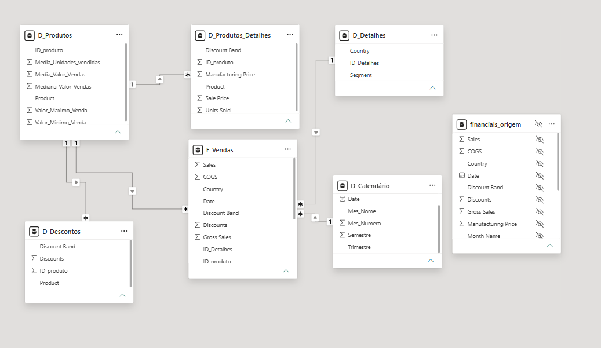

# 📊 Modelagem Dimensional — Star Schema de Vendas com Power BI

## 📌 Sobre o Projeto

Este projeto foi desenvolvido como parte de um desafio prático da **Digital Innovation One (DIO)**, com o objetivo de aplicar conceitos de modelagem dimensional, transformação de dados e criação de relacionamentos utilizando o Power BI.

A partir da base **Financial Sample**, disponibilizada pela Microsoft, foi construído um modelo analítico de vendas com uma tabela fato central, dimensões de produtos, detalhes e calendário, além de tabelas auxiliares.

O projeto utiliza Power Query para transformação dos dados e DAX para criação da dimensão calendário.

## 🎯 Objetivos

- Transformar uma base única de vendas em tabelas fato e dimensão.
- Aplicar técnicas de tratamento e organização de dados com Power Query.
- Utilizar agrupamentos e funções estatísticas.
- Criar identificadores para relacionar as tabelas.
- Construir uma dimensão calendário com DAX.
- Definir relacionamentos e cardinalidades no Power BI.
- Preparar um modelo para futuras análises de Business Intelligence.

## 🛠️ Tecnologias Utilizadas

- **Power BI Desktop:** construção e visualização do modelo.
- **Power Query:** extração, transformação e organização dos dados.
- **DAX:** criação da dimensão calendário.
- **Microsoft Excel:** fonte dos dados Financial Sample.
- **GitHub:** documentação e publicação do projeto.

## 🗂️ Estrutura do Modelo

### F_Vendas — Tabela Fato

Tabela central contendo os registros individuais de vendas.

Principais campos:

- SK_ID — identificador único da venda.
- ID_produto — identificador do produto.
- ID_Detalhes — identificador da combinação de segmento e país.
- Product — produto.
- Units Sold — unidades vendidas.
- Sale Price — preço de venda.
- Discount Band — faixa de desconto.
- Segment — segmento de mercado.
- Country — país.
- Sales — valor de vendas.
- Profit — lucro.
- Date — data da venda.
- Gross Sales — valor bruto.
- COGS — custo dos produtos vendidos.
- Discounts — descontos aplicados.

A tabela possui 700 registros, preservados após as transformações e mesclagens.

### D_Produtos

Dimensão contendo seis produtos e indicadores estatísticos:

- Média de unidades vendidas.
- Média do valor de vendas.
- Mediana do valor de vendas.
- Valor máximo de venda.
- Valor mínimo de venda.
- ID_produto.

### D_Produtos_Detalhes

Tabela auxiliar contendo informações de produtos e registros detalhados:

- ID_produto.
- Product.
- Discount Band.
- Sale Price.
- Units Sold.
- Manufacturing Price.

### D_Descontos

Tabela auxiliar contendo:

- ID_produto.
- Product.
- Discount Band.
- Discounts.

### D_Detalhes

Dimensão com combinações únicas de segmento e país:

- ID_Detalhes.
- Segment.
- Country.

### D_Calendário

Dimensão temporal criada com DAX:

- Date.
- Ano.
- Mes_Numero.
- Mes_Nome.
- Trimestre.
- Semestre.

### financials_origem

Tabela original preservada como referência e backup, oculta da exibição de relatório.

## 🔄 Transformações Realizadas no Power Query

1. Importação da base Financial Sample.
2. Preservação da consulta original.
3. Criação das consultas por referência e duplicação.
4. Seleção e reorganização das colunas.
5. Agrupamento por produto.
6. Cálculo de médias, mediana, máximos e mínimos.
7. Criação de colunas de índice.
8. Remoção de duplicatas na dimensão de detalhes.
9. Mesclagem de consultas para recuperar identificadores.
10. Validação dos 700 registros da tabela fato.

Também foram utilizados os recursos de perfil de dados para observar a distribuição, os valores válidos, os erros e os campos vazios.

## 📅 Fórmula DAX — Calendário

```dax
D_Calendário =
ADDCOLUMNS(
    CALENDAR(
        MIN(F_Vendas[Date]),
        MAX(F_Vendas[Date])
    ),
    "Ano", YEAR([Date]),
    "Mes_Numero", MONTH([Date]),
    "Mes_Nome", FORMAT([Date], "MMMM"),
    "Trimestre", "T" & QUARTER([Date]),
    "Semestre", IF(MONTH([Date]) <= 6, 1, 2)
)
```

A fórmula utiliza `CALENDAR` para gerar o intervalo de datas e `ADDCOLUMNS` para adicionar atributos temporais.

## 🔗 Relacionamentos

| Origem | Destino | Cardinalidade |
|---|---|---|
| D_Produtos[ID_produto] | F_Vendas[ID_produto] | 1:N |
| D_Detalhes[ID_Detalhes] | F_Vendas[ID_Detalhes] | 1:N |
| D_Calendário[Date] | F_Vendas[Date] | 1:N |
| D_Produtos[Product] | D_Descontos[Product] | 1:N |
| D_Produtos[Product] | D_Produtos_Detalhes[Product] | 1:N |

As duas últimas tabelas funcionam como estruturas auxiliares relacionadas à dimensão de produtos. Por isso, o modelo apresenta uma variação do esquema em estrela tradicional.

Essas tabelas possuem múltiplas linhas por produto e exigem cuidado na agregação de valores financeiros para evitar interpretações incorretas.

## ⭐ Diagrama do Modelo Dimensional



O diagrama apresenta os relacionamentos configurados no Power BI Desktop.

## 📁 Arquivos do Projeto

| Arquivo | Descrição |
|---|---|
|`Projeto_Star_Schema_Vendas.pbix` | Projeto desenvolvido no Power BI |
| `Star_Schema_Vendas.png` | Imagem do modelo dimensional |
| `README.md` | Documentação do projeto |

## 📚 Aprendizados

Este projeto proporcionou a aplicação prática de conceitos como:

- Modelagem dimensional.
- Transformação e preparação de dados.
- Identificação de tabelas fato e dimensão.
- Criação de chaves de relacionamento.
- Agrupamentos e cálculos estatísticos.
- Utilização de Power Query e linguagem M.
- Desenvolvimento de tabelas calculadas com DAX.
- Validação de cardinalidades e relacionamentos.

## ✅ Conclusão

O projeto permitiu transformar uma base de vendas em um modelo analítico estruturado, aplicando técnicas de preparação de dados e relacionamentos no Power BI.

O desenvolvimento reforçou conhecimentos fundamentais para a atuação em Análise de Dados e Business Intelligence, especialmente em modelagem dimensional, Power Query e DAX.

---

Projeto desenvolvido para fins educacionais como parte de um desafio da **Digital Innovation One (DIO)**.
